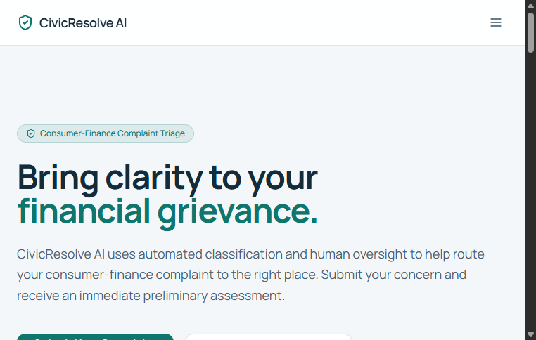
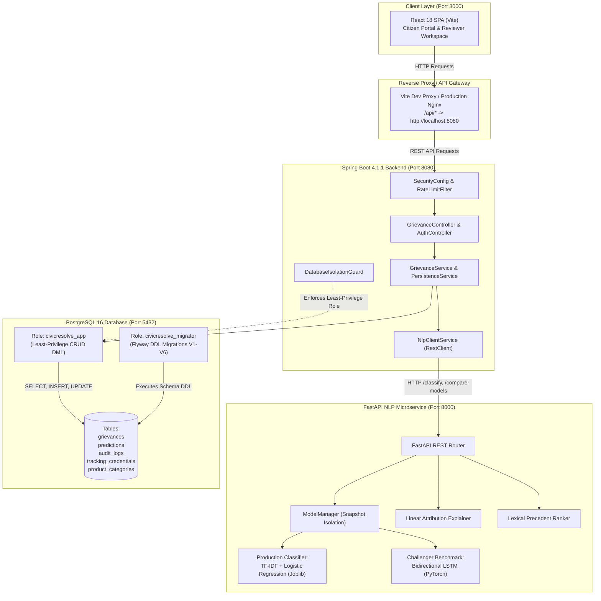

# CivicResolve AI — Consumer Grievance Intelligence & Automated Triage Platform

CivicResolve AI is an enterprise-grade consumer financial grievance triage and decision intelligence platform engineered for regulated financial institutions and compliance teams. It bridges public citizen intake with explainable natural language processing, dual-model comparison, human-in-the-loop adjudication workflows, and strict defense-in-depth security controls.



---

## Table of Contents

1. [Project Overview & Problem Statement](#1-project-overview--problem-statement)
2. [Key Features & User Workflows](#2-key-features--user-workflows)
3. [Technology Stack](#3-technology-stack)
4. [System Architecture](#4-system-architecture)
5. [Repository Structure](#5-repository-structure)
6. [Machine Learning Methodology & Validation Results](#6-machine-learning-methodology--validation-results)
7. [Flagship Decision Intelligence Lab](#7-flagship-decision-intelligence-lab)
8. [Database & Security Architecture](#8-database--security-architecture)
9. [Prerequisites & Environment Setup](#9-prerequisites--environment-setup)
10. [Environment Variable Configuration](#10-environment-variable-configuration)
11. [Startup Commands](#11-startup-commands)
12. [Testing & Verification Instructions](#12-testing--verification-instructions)
13. [Dataset Provenance & Model Artifact Setup](#13-dataset-provenance--model-artifact-setup)
14. [Known Limitations & Disclaimers](#14-known-limitations--disclaimers)
15. [License](#15-license)

---

## 1. Project Overview & Problem Statement

Financial institutions handle millions of consumer complaints regarding mortgages, credit cards, debt collection, credit reporting, bank accounts, and student loans. Manual triage creates substantial operational and regulatory bottlenecks:

- **SLA Breaches & Ingestion Latency**: High narrative volume overwhelms manual routing queues, jeopardizing statutory response windows.
- **Inconsistent Categorization**: Complex or ambiguous grievances (e.g., identity theft impacting credit reports and collections simultaneously) are frequently misassigned across disparate departments.
- **Consumer Trust Deficit**: Citizens typically submit complaints into opaque systems without verifiable cryptographic receipts or real-time progression visibility.
- **Black-Box AI Risk**: Autonomous deep neural networks cannot be deployed blindly in regulated compliance workflows without deterministic feature attribution, auditability, and human override capabilities.

**CivicResolve AI resolves these challenges through:**
- **Instant Citizen Safeguards**: Real-time pre-submission triage feedback and privacy-first narrative evaluation before submission.
- **Explainable Linear Feature Attribution**: Deterministic n-gram token weighting that explicitly demonstrates *why* a complaint was categorized into a specific product bucket.
- **Cryptographic Tracking Tokens**: High-entropy, one-time tracking credentials where only salted SHA-256 hashes are persisted.
- **Flagship Decision Intelligence Lab**: A dedicated 3-Zone reviewer workbench featuring counterfactual what-if simulation, live dual-model comparison, precedent consistency analysis using Lexical TF-IDF Cosine Similarity, and statutory audit timelines.
- **Enterprise Defense-in-Depth**: Strict PostgreSQL dual-role separation (least-privilege DML vs. Flyway DDL migrator), optimistic concurrency locking (`HTTP 409`), in-memory token-bucket rate limiting, and RFC 9457 structured error handling.

---

## 2. Key Features & User Workflows

### A. Public Citizen Intake & Tracking Journey
1. **Interactive Triage Hero (`/`)**:
   - Live interactive complaint simulator demonstrating how narratives are processed across 8 standardized CFPB financial categories.
2. **Submit Grievance Portal (`/submit`)**:
   - Accessible form enforcing client- and server-side narrative validation (20 to 5,000 characters).
   - Pre-submission client safeguard inspector and explicit privacy notice disclosing PII redaction.
3. **One-Time Cryptographic Tracking Receipt**:
   - On submission, the citizen receives a unique reference number (e.g., `CR-2026-XXXX`) and a high-entropy tracking secret (`trk_...`).
   - The plaintext secret is displayed **only once**; only its SHA-256 hash is persisted in PostgreSQL.
4. **Scrubbed Public Tracking Timeline (`/track`)**:
   - Citizens track case progress via Reference ID + Secret.
   - Internal reviewer notes, employee identities, and raw ML attributions are strictly scrubbed from public tracking responses.
   - Built-in token-bucket IP rate limiter protects against credential brute-force attacks.

### B. Adjudication & Compliance Officer Journey
1. **Authenticated Reviewer Portal (`/reviewer/login`)**:
   - Secured by Spring Security HTTP Basic authentication with BCrypt-12 hashed credentials.
2. **Reviewer Queue & Dashboard (`/reviewer/dashboard`)**:
   - Real-time queue filtering by status (`AUTO_ROUTED`, `PENDING_REVIEW`, `UNDER_INVESTIGATION`, `RESOLVED`, `DISMISSED`) and priority (`LOW`, `MEDIUM`, `HIGH`, `CRITICAL`).
   - Optimistic concurrency control via JPA `@Version` prevents race conditions with standard `HTTP 409 Conflict`.
3. **Decision Intelligence Lab (`/reviewer/grievances/:id`)**:
   - Comprehensive investigation environment combining immutable case anchors, what-if narrative experimentation, live dual-model arbitration, and precedent retrieval via Lexical TF-IDF Cosine Similarity.
4. **Executive Analytics & Model Audit (`/reviewer/audit`)**:
   - Real-time aggregations of category volumes, reviewer override frequencies, probability margin distributions, and model calibration metrics.

---

## 3. Technology Stack

| Tier | Component | Technology & Frameworks | Version / Details |
| :--- | :--- | :--- | :--- |
| **Frontend** | Single Page Application | React 18, TypeScript, Vite | Tailwind CSS, Lucide Icons, Headless UI, Vitest, Testing Library |
| **Backend API** | Enterprise REST Service | Java 21 / 25, Spring Boot | Spring Boot 4.1.1, Spring Data JPA, Spring Security, Hibernate 7, Flyway 10, HikariCP |
| **NLP Microservice** | Inference Engine & Triage | Python 3.11+, FastAPI, Uvicorn | Scikit-learn, PyTorch, Pandas, NumPy, Pydantic v2, Joblib, VADER Sentiment |
| **Persistence** | Relational Database | PostgreSQL 16+ | Flyway Schema Migrations (V1–V6), Dual-Role Security Isolation |
| **Protocols & Standards** | API & Security Standards | REST, RFC 9457 Problem Details | HTTP Basic Auth (BCrypt-12), SHA-256 Hashing, Token Bucket Limiting |

---

## 4. System Architecture



---

## 5. Repository Structure

```
CivicResolveAI/
├── .gitignore                          # Comprehensive multi-tier ignore policy
├── README.md                           # Master portfolio and operational guide
├── landing.png                         # Architectural overview diagram
├── reviewer_login.png                  # Reviewer portal preview
├── submit.png                          # Citizen complaint intake preview
├── track.png                           # Citizen complaint tracking preview
│
├── backend/                            # Spring Boot 4.1.1 API Tier
│   ├── mvnw / mvnw.cmd                 # Maven wrapper scripts
│   ├── pom.xml                         # Maven dependencies and build targets
│   └── src/
│       ├── main/
│       │   ├── java/ai/civicresolve/backend/
│       │   │   ├── config/             # SecurityConfig, RateLimit, RestClient, IsolationGuard
│       │   │   ├── controller/         # GrievanceController, AuthController, HealthController
│       │   │   ├── dto/                # Request/Response records with explicit JsonProperty mappings
│       │   │   ├── entity/             # JPA entities (Grievance, Prediction, AuditLog, etc.)
│       │   │   ├── exception/          # RFC 9457 GlobalExceptionHandler & custom exceptions
│       │   │   ├── repository/         # Spring Data JPA repositories
│       │   │   └── service/            # Core business, persistence, tracking, rate limiter
│       │   └── resources/
│       │       ├── application.properties
│       │       └── db/migration/       # Flyway SQL migrations (V1 to V6)
│       └── test/                       # 263 Unit tests & 23 live PostgreSQL integration tests
│
├── frontend/                           # React 18 + TypeScript + Vite SPA
│   ├── package.json                    # Frontend dependencies & npm scripts
│   ├── vite.config.ts                  # Vite configuration & dev proxy
│   ├── tailwind.config.js              # Theme, tokens, typography
│   ├── src/
│   │   ├── app/                        # App root, React Router, AuthProvider
│   │   ├── components/                 # Shared UI components (Button, Input, Alert, Modal)
│   │   ├── features/                   # Feature slices:
│   │   │   ├── auth/                   # In-memory authentication client
│   │   │   ├── intake/                 # Public submission & receipt
│   │   │   ├── tracking/               # Public complaint status tracker
│   │   │   └── reviewer/               # Flagship Reviewer Workspace & Decision Intelligence Lab
│   │   │       ├── components/         # DecisionIntelligenceLab, HistoricalPattern, WhatIfDrawer
│   │   │       ├── hooks/              # useTriageShortcuts, navigation
│   │   │       └── ReviewerGrievanceDetailPage.tsx
│   │   └── lib/api/                    # Type-safe API client and endpoint contracts
│   └── tests/                          # 202 Vitest unit, component, and a11y tests (32 files)
│
└── nlp-service/                        # Python FastAPI Microservice
    ├── requirements.txt                # Python dependencies (scikit-learn, torch, fastapi)
    ├── app/
    │   ├── main.py                     # FastAPI application & REST endpoints
    │   ├── config.py                   # Pydantic settings & threshold configs
    │   ├── schemas.py                  # Pydantic request/response schemas
    │   ├── models/bilstm.py            # PyTorch Bi-LSTM neural network architecture
    │   ├── preprocessing/cleaner.py    # Text cleaning, normalization & PII scrubbing
    │   └── services/                   # ModelManager, Explainer, Triage rule engine
    ├── models_saved/                   # Model artifacts & benchmark evaluations
    │   ├── baseline_tfidf_logreg.joblib # Production classifier (5.02 MB)
    │   ├── bilstm_best.pt              # Challenger benchmark model (34.33 MB)
    │   ├── bilstm_config.json          # Neural network hyperparameters
    │   ├── vocab.json                  # Vocabulary token-to-index mapping
    │   └── *.json / *.csv              # Calibration metrics & confusion matrices
    └── tests/                          # 145 Pytest unit, concurrency, and validation tests
```

---

## 6. Machine Learning Methodology & Validation Results

CivicResolve AI implements an authentic 8-category consumer financial product taxonomy based on historical Consumer Financial Protection Bureau (CFPB) complaint data:

1. `Checking or savings account`
2. `Credit card`
3. `Credit reporting or other personal consumer reports`
4. `Debt collection`
5. `Money transfer, virtual currency, or money service`
6. `Mortgage`
7. `Student loan`
8. `Vehicle loan or lease`

### Primary Production Model: TF-IDF + Logistic Regression
- **Role**: **Authoritative classifier**. It is the sole model used for automated routing and persistence upon complaint submission (`POST /api/grievances`).
- **Vectorization**: Sublinear term-frequency scaling, n-gram range `(1, 2)`, min document frequency 5, max features 50,000.
- **Classifier**: Multi-class Logistic Regression with L2 regularization ($C = 1.0$), multinomial loss, balanced class weighting, L-BFGS solver.
- **Footprint & Speed**: ~5.02 MB serialized footprint, $< 15\text{ ms}$ single-pass inference latency.
- **Linear Attribution**: Token coefficients $\mathbf{w}_c \cdot \mathbf{x}$ provide mathematically exact, deterministic attribution shifts without stochastic Monte Carlo variance.
- **Validation Results (Stratified Validation Set, N=12,726)**:
  - **Macro F1**: `0.7453`
  - **Weighted F1**: `0.8455`
  - **Accuracy**: `83.80%`

### Challenger Benchmark Model: Bidirectional LSTM (PyTorch)
- **Role**: **Reviewer-only challenger**. Operates strictly inside the reviewer workspace to provide a second opinion; it never performs autonomous routing.
- **Architecture**:
  - Tokenizer: Custom vocab of 20,000 most frequent tokens; zero-padding up to sequence length 250.
  - Embedding Layer: Dense 128-dimensional continuous embeddings.
  - Recurrent Backbone: 2-layer Bidirectional LSTM ($h = 128$, dropout = 0.3).
  - Classification Head: Dense linear projection to 8 logits followed by Softmax.
- **Footprint**: ~34.33 MB PyTorch state dictionary checkpoint (`bilstm_best.pt`).
- **Utility**: Evaluates complex syntactic dependencies and captures context in verbose narratives where n-gram linear models exhibit uncertainty.
- **Validation Results (Stratified Validation Set, N=12,726)**:
  - **Macro F1**: `0.7067`
  - **Weighted F1**: `0.8230`
  - **Accuracy**: `81.24%`

### AI Ethics & Terminology Standards
All model probability estimates in CivicResolve AI are explicitly presented as:
> *"Uncalibrated model probability estimates"* and *"AI-assisted preliminary triage"*.
CivicResolve AI serves as an intelligence amplifier for human compliance officers; it does not replace human oversight or make autonomous binding legal adjudications.

---

## 7. Flagship Decision Intelligence Lab

The reviewer interface (`/reviewer/grievances/:id`) contains our flagship interactive investigation workspace: the **Decision Intelligence Lab (Counterfactual Case Replay & Decision Consistency Workspace)**.

```
┌───────────────────────────────────────────────────────────────────────────────────────────────────────┐
│ Reviewer Grievance Detail Page (Desktop Grid: 65% Main Investigation / 35% Sticky Review Dock)         │
├─────────────────────────────────────────────────────────────┬─────────────────────────────────────────┤
│ Left Column (65%): Main Investigation & Lab                 │ Right Column (35%): Sticky Review Dock  │
│ ┌─────────────────────────────────────────────────────────┐ │ ┌─────────────────────────────────────┐ │
│ │ Zone A: Immutable Case Anchor                           │ │ │ Adjudication Controls               │ │
│ │ • "IMMUTABLE PERSISTED RECORD" Badge                    │ │ │ • Action: APPROVE / OVERRIDE / etc. │ │
│ │ • Version Pill, SLA Counter, Provenance SHA-256         │ │ │ • Target Priority / Target Category │ │
│ │ • Original Narrative Display                            │ │ │ • Reason / Adjudication Note Input  │ │
│ │ • Linear Feature Attributions & Diverging Bar Chart     │ │ └─────────────────────────────────────┘ │
│ └─────────────────────────────────────────────────────────┘ │ ┌─────────────────────────────────────┐ │
│ ┌─────────────────────────────────────────────────────────┐ │ │ Audit History Timeline              │ │
│ │ Decision Intelligence Lab Tabs:                         │ │ │ • Chronological immutable entries   │ │
│ │ [Counterfactual Simulation]  [Precedent Consistency]    │ │ └─────────────────────────────────────┘ │
│ │                                                         │ └─────────────────────────────────────────┘
│ │ Zone B: What-If Narrative Lab                           │
│ │ • 4 Synthetic Presets ("SYNTHETIC DEMO SCENARIO")       │
│ │ • Simulation Textarea (10–10,000 chars)                 │
│ │ • Live Delta Badges (Words: ±Δ, Chars: ±Δ)              │
│ │ • Actions: "Reset to Original", "Compare Models & Run"  │
│ ├─────────────────────────────────────────────────────────┤
│ │ Zone C: Live Dual-Model Comparison                      │
│ │ • Model Agreement / Disagreement Banner                 │
│ │ • Side-by-Side Confidence & Top-2 Margin Meters         │
│ │ • Exact Telemetry: Active Features vs Sequence Tokens   │
│ │ • Delta Telemetry vs Zone A Anchor                      │
│ │ • Model Provenance Check                                │
│ │ • Statutory & ML Governance Disclosure                  │
│ │ • Action: "Copy Replay Summary to Review Note"          │
│ └─────────────────────────────────────────────────────────┘
└───────────────────────────────────────────────────────────────────────────────────────────────────────┘
```

### Lab Components & Capabilities:
1. **Zone A (Immutable Persisted Anchor)**:
   - Displays the permanent complaint narrative, original baseline prediction, SLA status, and active model version hash.
   - Houses the `LinearAttributionHighlighter` and `DivergingFeatureBarChart` highlighting positive and negative token forces.
2. **Zone B (Counterfactual "What-If" Narrative Lab)**:
   - Provides an isolated sandbox editor (`10–10,000` chars) allowing reviewers to simulate narrative modifications (e.g., adding explicit debt validation terms or removing payment references).
   - Live **Word (±Δ)** and **Character (±Δ)** delta badges compute differences in real time.
   - Includes 4 pre-configured synthetic scenarios badged `"SYNTHETIC DEMO SCENARIO — NOT SAVED"`. Clicking a preset only updates the editor text—it dispatches zero network calls and renders zero hardcoded predictions.
3. **Zone C (Live Dual-Model Live Comparison & Telemetry)**:
   - Dispatches single-pass inference across both the production TF-IDF model and challenger Bi-LSTM.
   - Renders exact metric labels:
     - `"Top-2 Probability Margin (P₁ - P₂)"`
     - `"Active TF-IDF N-Gram Features (of 50,000)"`
     - `"Non-Padding Sequence Tokens (max_len=200/250, truncated: true/false)"`
   - Highlights confidence deltas vs. Zone A and verifies model provenance integrity.
   - **"Copy Replay Summary to Review Note"**: Appends markdown replay evidence to the review note safely without auto-submitting the decision.
4. **Historical Decision Consistency Panel**:
   - Retrieves top historical precedents ranked via Lexical TF-IDF Cosine Similarity.
   - Computes category agreement independently of administrative workflow status.
   - Accurately accounts for priority-only overrides (`OVERRIDDEN` where `predictedCategory === assignedCategory`).
   - Renders an **Amber Evidence Sufficiency Warning** whenever historical sample size < 2 or max cosine similarity < 0.25.

---

## 8. Database & Security Architecture

### PostgreSQL Dual-Role Principle of Least Privilege
CivicResolve AI enforces strict separation between database schema administration (DDL) and application runtime execution (DML):

| Database Role | Permitted Operations | Prohibited Operations | Purpose |
| :--- | :--- | :--- | :--- |
| `civicresolve_migrator` | `CREATE`, `ALTER`, `DROP`, Flyway DDL | Application CRUD | Automated Flyway migrations during startup |
| `civicresolve_app` | `SELECT`, `INSERT`, `UPDATE` | `CREATE`, `DROP`, `ALTER`, `TRUNCATE` | Spring Boot HikariCP connection pool |

Startup validation in `DatabaseIsolationGuard.java` verifies that `civicresolve_app` does not possess superuser or DDL capabilities, terminating startup if permissions are misconfigured.

### Security Defenses
- **In-Memory Reviewer Authentication**: Spring Security HTTP Basic authentication with BCrypt-12 hashed credentials. Credentials are kept strictly in memory in the React client and are never written to `localStorage` or `sessionStorage`.
- **Public vs. Protected Scope**: Public access is strictly restricted to `/api/grievances` (POST intake), `/api/grievances/track` (POST status check), `/api/product-categories`, and `/api/health`. All triage queues, reviews, and analytics require `ROLE_REVIEWER`.
- **One-Time Citizen Credentials**: Tracking secrets are generated via cryptographically secure randomness (`SecureRandom`). Only the salted SHA-256 hash is persisted; raw secrets are never stored or logged.
- **Fail-Closed IP Rate Limiting**: In-memory token-bucket rate limiter with bounded capacity failing closed under load, defending against tracking enumeration attacks.
- **Optimistic Concurrency Locking**: Entity `@Version` field on `Grievance` prevents review race conditions, returning `409 Conflict` (RFC 9457) when concurrent modifications occur.
- **RFC 9457 Problem Details**: Consistent, structured error responses (`application/problem+json`) with unique error types, status codes, timestamps, and request path context.

---

## 9. Prerequisites & Environment Setup

### Required Tooling
- **Java**: OpenJDK 21 or 25 (`java -version`)
- **Maven**: Version 3.9+ (or use the included `./backend/mvnw.cmd` / `./backend/mvnw`)
- **Node.js**: Version 18.0+ & npm (`node -v`, `npm -v`)
- **Python**: Version 3.11+ (`python --version`)
- **PostgreSQL**: Version 16+ (`psql --version`)

---

## 10. Environment Variable Configuration

All sensitive credentials and database connection parameters are passed via environment variables. **Never commit actual passwords or private tokens to source control.**

### PowerShell (Windows)
```powershell
# ==============================================================================
# CivicResolve AI — Environment Configuration (PowerShell)
# ==============================================================================

# Application Datasource (civicresolve_app — least-privilege DML role)
$env:SPRING_DATASOURCE_URL      = "jdbc:postgresql://127.0.0.1:5432/civicresolve"
$env:SPRING_DATASOURCE_USERNAME = "civicresolve_app"
$env:SPRING_DATASOURCE_PASSWORD = "<YOUR_APP_ROLE_PASSWORD>"

# Flyway Migrations Datasource (civicresolve_migrator — DDL schema role)
$env:SPRING_FLYWAY_URL          = "jdbc:postgresql://127.0.0.1:5432/civicresolve"
$env:SPRING_FLYWAY_USER         = "civicresolve_migrator"
$env:SPRING_FLYWAY_PASSWORD     = "<YOUR_MIGRATOR_ROLE_PASSWORD>"

# FastAPI NLP Microservice URL
$env:NLP_SERVICE_URL            = "http://127.0.0.1:8000"

# Reviewer Account Password (BCrypt-12 hashed at startup)
$env:REVIEWER_PASSWORD          = "<YOUR_SECURE_REVIEWER_PASSWORD>"
```

### Bash (macOS / Linux)
```bash
# ==============================================================================
# CivicResolve AI — Environment Configuration (Bash)
# ==============================================================================

export SPRING_DATASOURCE_URL="jdbc:postgresql://127.0.0.1:5432/civicresolve"
export SPRING_DATASOURCE_USERNAME="civicresolve_app"
export SPRING_DATASOURCE_PASSWORD="<YOUR_APP_ROLE_PASSWORD>"
export SPRING_FLYWAY_URL="jdbc:postgresql://127.0.0.1:5432/civicresolve"
export SPRING_FLYWAY_USER="civicresolve_migrator"
export SPRING_FLYWAY_PASSWORD="<YOUR_MIGRATOR_ROLE_PASSWORD>"
export NLP_SERVICE_URL="http://127.0.0.1:8000"
export REVIEWER_PASSWORD="<YOUR_SECURE_REVIEWER_PASSWORD>"
```

---

## 11. Startup Commands

### Step 1: Database Initialization
Connect to PostgreSQL as administrator (`postgres`) and execute:
```sql
CREATE DATABASE civicresolve;
CREATE ROLE civicresolve_migrator WITH LOGIN PASSWORD '<YOUR_MIGRATOR_ROLE_PASSWORD>';
CREATE ROLE civicresolve_app WITH LOGIN PASSWORD '<YOUR_APP_ROLE_PASSWORD>';

\c civicresolve
GRANT ALL PRIVILEGES ON SCHEMA public TO civicresolve_migrator;
GRANT USAGE ON SCHEMA public TO civicresolve_app;
ALTER DEFAULT PRIVILEGES IN SCHEMA public GRANT SELECT, INSERT, UPDATE, DELETE ON TABLES TO civicresolve_app;
ALTER DEFAULT PRIVILEGES IN SCHEMA public GRANT USAGE, SELECT ON SEQUENCES TO civicresolve_app;
```

### Step 2: Start the FastAPI NLP Service (Port 8000)
```powershell
cd nlp-service
python -m venv .venv
.\.venv\Scripts\Activate.ps1
pip install -r requirements.txt
uvicorn app.main:app --host 127.0.0.1 --port 8000
```
*Health Check*: Verify at `http://127.0.0.1:8000/health`.

### Step 3: Start the Spring Boot Backend (Port 8080)
From the project root:
```powershell
# Ensure environment variables are loaded in your current shell
.\backend\mvnw.cmd spring-boot:run
```
*Health Check*: Verify at `http://127.0.0.1:8080/api/health`. Flyway automatically applies migrations `V1` through `V6` on initial startup.

### Step 4: Start the React Frontend (Port 3000)
From the project root:
```powershell
cd frontend
npm install
npm run dev
```
Open `http://localhost:3000` in your browser. Reviewer portal is located at `http://localhost:3000/reviewer/login` (Username: `reviewer`, Password: value of `REVIEWER_PASSWORD`).

---

## 12. Testing & Verification Instructions

### Backend Unit & Integration Tests
```powershell
# Execute all 263 unit and slice tests
.\backend\mvnw.cmd test

# Execute live PostgreSQL integration tests (Failsafe plugin)
# Note: Requires SPRING_DATASOURCE_PASSWORD targeting dedicated civicresolve_test database
.\backend\mvnw.cmd verify
```
*Verified result*: `Tests run: 263, Failures: 0, Errors: 0, Skipped: 0` (`BUILD SUCCESS`).

### Frontend Test Suite
```powershell
cd frontend

# Execute full Vitest suite (202 tests across 32 files)
npm test

# Verify TypeScript compilation and production bundle build
npm run build
```
*Verified result*: `Test Files: 32 passed (32), Tests: 202 passed (202)`.

### NLP Microservice Tests
```powershell
cd nlp-service

# Execute all 145 Pytest unit, concurrency, and validation tests
pytest tests/ -v
```
*Verified result*: `145 passed in nlp-service/tests`.

---

## 13. Dataset Provenance & Model Artifact Setup

### CFPB Dataset Provenance
CivicResolve AI is trained on historical consumer financial grievances from the Consumer Financial Protection Bureau (CFPB) public repository.
- **Historical Context**: In September 2026, the official CFPB public database restricted raw consumer complaint narratives from public API endpoints.
- Pre-removal historical snapshots (covering complaints through mid-2026) are preserved on public research platforms (e.g., Hugging Face `vivekkopthsd/cfpb-consumer-complaints`).
- Pre-split deduplication and stratified sampling pipelines are documented in `nlp-service/training/data_split.py`.

### Model Artifacts Included Directly
To ensure immediate execution upon cloning, safe pre-trained model weights are included directly in `nlp-service/models_saved/` under standard GitHub file limits:
- `baseline_tfidf_logreg.joblib` (5.02 MB): Production TF-IDF vectorizer and calibrated logistic regression weights.
- `bilstm_best.pt` (34.33 MB): PyTorch checkpoint for the challenger neural network.
- `vocab.json` (487 KB) & `bilstm_config.json` (1 KB): Vocabulary index and hyperparameter configurations.
- `baseline_eval_*.json`, `bilstm_eval_*.json`: Evaluation metrics and validation confusion matrices.

> **Data Protection Note:** The held-out test evaluation dataset (`nlp-service/data/processed/test.csv`) and raw CSV records are strictly excluded from source control to maintain data protection and academic integrity.

---

## 14. Known Limitations & Disclaimers

1. **Pre-Removal Snapshot Boundary**: Complaint narratives reflect historical CFPB structures; production deployments connecting to external regulatory APIs must incorporate authorized narrative ingestion streams.
2. **Statutory & Legal Scope**: CivicResolve AI provides intelligent preliminary triage recommendations. It is not an automated judicial engine and does not make binding legal determinations without human reviewer adjudication.
3. **Single-Node Rate Limiter**: The current IP rate limiter operates in-memory; enterprise multi-region clusters should configure a distributed Redis cache.
4. **Hardware Acceleration**: The PyTorch Bi-LSTM challenger runs CPU inference by default for portable local deployment; high-throughput batch evaluation benefits from a CUDA-capable runtime.

---

## 15. License

This project is licensed under the Apache 2.0 License.
