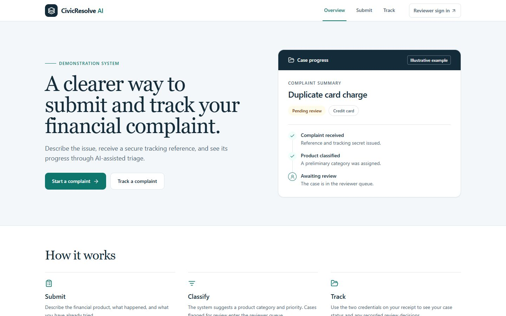
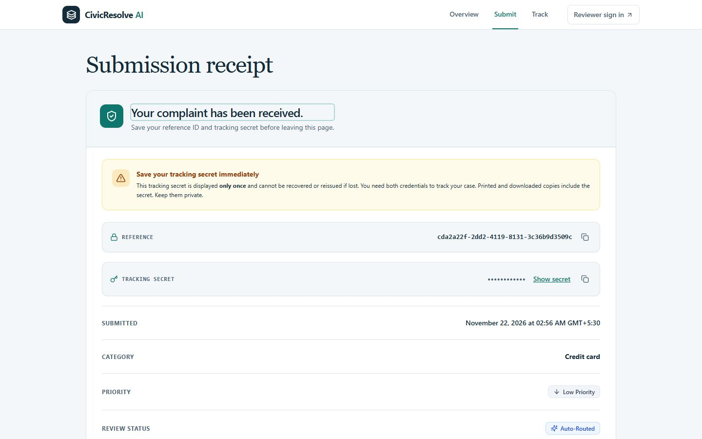
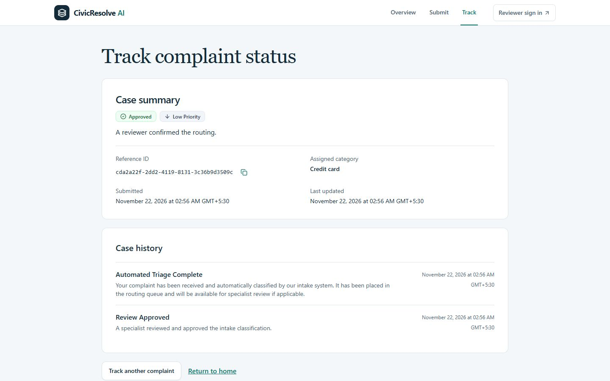
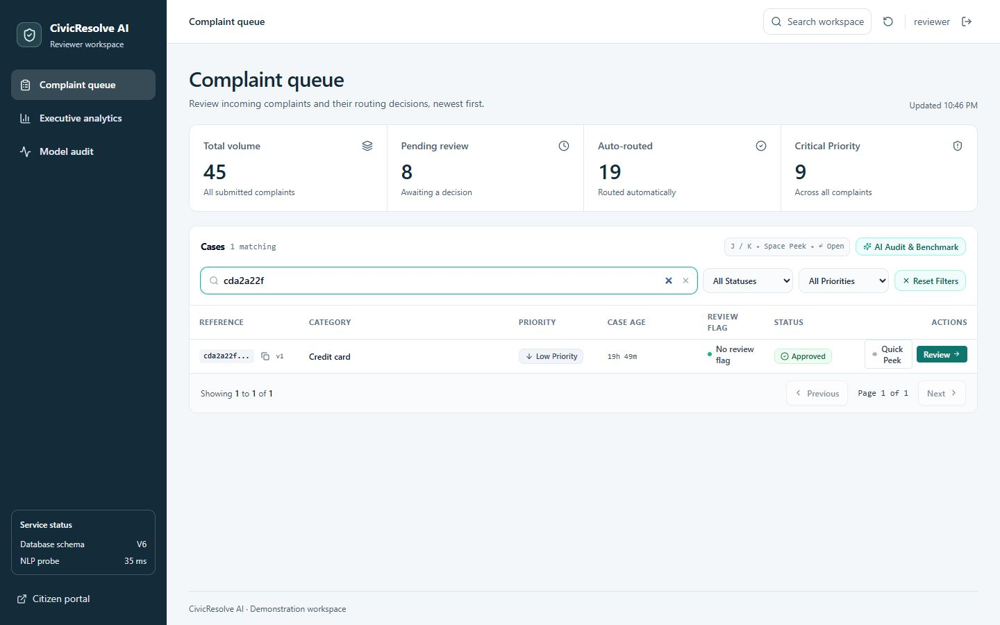
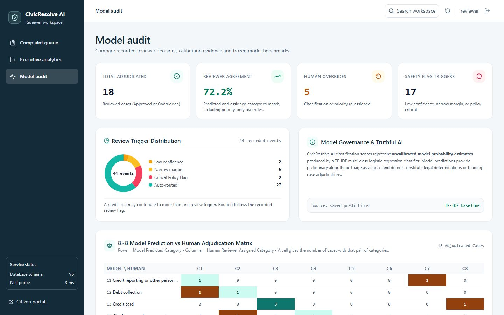
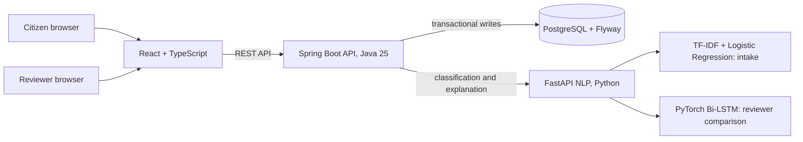

# CivicResolve AI

**Explainable Financial Complaint Intelligence & Human-in-the-Loop Review**

CivicResolve AI is a working demonstration of financial complaint intake and review. A citizen submits a narrative, receives an AI-assisted product category and priority, and gets a one-time secret to track the case. A reviewer can inspect the recorded prediction and explanation, make a decision, and see the audit history. The interesting engineering problem is keeping that journey consistent across a React client, a transactional Spring Boot API, PostgreSQL, and a separate FastAPI model service. This is **not** a certified production financial service; use fictional complaints only.

[](https://github.com/Gaurav-Ojha65/CivicResolveAI/actions/workflows/ci.yml) [](LICENSE)   

[Screenshots](#product-screenshots) · [Capabilities](#what-works) · [Architecture](#architecture) · [Model evaluation](#model-evaluation) · [Quick start](#quick-start) · [Testing](#verification) · [Documentation](#documentation)



*The current landing page, captured from merged `main` at 1440 px on November 22, 2026. Its case-progress card is labeled as an illustrative example.*

## Product screenshots

All screenshots below come from the running application with fictional data. The receipt image masks the one-time tracking secret. Values on analytics screens reflect that disposable test database at capture time; they are not product usage claims.

<details>
<summary><strong>Citizen experience</strong> — intake, receipt, and tracking</summary>

<p align="center">
  
  
</p>

| View | Evidence |
| --- | --- |
| Landing | [Desktop](docs/assets/screenshots/landing-1440.jpg) · [Mobile](docs/sprint2-visual-qa/after-overview-375.jpg) — explains the demonstration and offers intake and tracking. |
| Complaint submission | [Mobile](docs/sprint2-visual-qa/after-submit-375.jpg) — narrative intake and AI-assisted preview. |
| One-time receipt | [Redacted desktop](docs/assets/screenshots/receipt-redacted-1440.jpg) — reference ID and concealed secret with save instructions. |
| Complaint tracking | [Approved case desktop](docs/assets/screenshots/tracking-approved-1440.jpg) · [Mobile lookup](docs/sprint2-visual-qa/after-track-375.jpg) — public status and a scrubbed timeline. |

</details>

<details>
<summary><strong>Reviewer experience</strong> — queue, decision, analytics, and audit</summary>

<p align="center">
  
  
</p>

| View | Evidence |
| --- | --- |
| Reviewer sign-in | [Mobile](docs/sprint2-visual-qa/after-login-375.jpg) — protected workspace entry. |
| Searchable queue | [Desktop](docs/assets/screenshots/reviewer-queue-1440.jpg) · [Mobile](docs/sprint2-visual-qa/after-queue-375.jpg) — backend search, status and priority filters, and pagination. |
| Investigation and explanation | [Expanded feature attribution](docs/assets/screenshots/reviewer-explanation-1440.jpg) · [Mobile case review](docs/sprint2-visual-qa/after-case-375.jpg) — recorded category, confidence, margin, feature contributions, and audit history. |
| Human review controls | [Approved case desktop](docs/assets/screenshots/reviewer-case-approved-1440.jpg) — approval, override, or rejection controls and the recorded outcome. |
| Executive analytics | [Desktop](docs/assets/screenshots/analytics-1440.jpg) · [Mobile](docs/sprint2-visual-qa/after-analytics-375.jpg) — aggregates from stored cases. |
| Model audit | [Desktop](docs/assets/screenshots/model-audit-1440.jpg) · [Mobile](docs/sprint2-visual-qa/after-audit-375.jpg) — recorded decisions, triggers, and model comparisons. |

</details>

[Screenshot provenance](docs/assets/screenshots/README.md) · [Sprint 2 visual QA history and before/after images](docs/sprint2-visual-qa/README.md)

## What works

| Citizen portal | Reviewer workspace | AI and decision support |
| --- | --- | --- |
| Narrative submission and preliminary category/priority assessment | HTTP Basic reviewer access with credentials held in browser memory | TF-IDF + balanced Logistic Regression serves intake across eight CFPB product categories |
| One-time tracking reference and secret; only a salted hash of the secret is stored | Server-side search, filters, deterministic ordering, and pagination | Confidence and top-two margin display with uncalibrated-score warning |
| Secret-gated status lookup with a scrubbed public timeline | Original prediction, feature attribution, approve/override/reject actions, and audit history | Rule-based urgency triggers, counterfactual preview, lexical precedent matching, and reviewer-only PyTorch Bi-LSTM comparison |
| Privacy-aware submission receipt | Stored-case operational analytics and model audit | Versioned model artifacts and explanations retained with predictions |

The Bi-LSTM is a **challenger for reviewer comparison**. Only the TF-IDF model's result is used for automated intake routing. The interface does not make a binding legal or financial decision.

## Architecture



React handles intake, secret-gated tracking, and the reviewer workspace. Spring Boot validates requests, enforces reviewer authorization, coordinates model inference and atomic database writes, and converts failures into structured API errors. FastAPI loads the saved model artifacts and returns predictions and explanations; PostgreSQL stores the case, original prediction, tracking-secret hash, and audit events. A review updates the case and appends an audit record in one transaction. Optimistic locking rejects a stale reviewer version with HTTP 409. Public tracking returns a deliberately reduced view and never exposes the reviewer note or model explanation.

[Detailed service boundaries, sequence diagrams, and endpoint directory](docs/ARCHITECTURE.md)

## Model evaluation

The [model card](docs/MODEL_CARD.md) documents a curated historical CFPB complaint corpus of **84,842** narratives, deduplicated before a stratified **59,389 / 12,726 / 12,727** train/validation/held-out test split. The table below is from the committed **validation** evaluations, not from live usage or external regulatory validation.

| Validation metric, 12,726 narratives | TF-IDF + Logistic Regression | Bi-LSTM challenger |
| --- | ---: | ---: |
| Accuracy | 83.80% | 81.24% |
| Macro F1 | 0.7453 | 0.7067 |

Sources: [baseline validation JSON](nlp-service/models_saved/baseline_eval_val.json) and [challenger validation JSON](nlp-service/models_saved/bilstm_eval_val.json). The held-out test narratives are excluded from this repository; a separate [recorded read-only final evaluation](nlp-service/models_saved/final_test_evaluation_report.md) exists. The credit-reporting class dominates the corpus, while smaller classes have less support and lower per-class F1. The model probabilities are **uncalibrated estimates**. See the [per-class results and intended-use limits](docs/MODEL_CARD.md) before interpreting any score.

## Engineering decisions

- **Separated service boundaries:** model inference can change independently of reviewer UI and persistence rules. An NLP outage interrupts classification; the backend does not invent a prediction.
- **Transactional persistence:** submission keeps a case, prediction, tracking hash, and audit event together. Review keeps the status change and its audit event together.
- **Database role isolation and Flyway:** the application role performs limited data operations; a separate migrator role owns schema changes. Migrations and PostgreSQL integration tests guard the actual database contract.
- **Concurrency and provenance:** JPA `@Version` and HTTP 409 protect reviewer decisions from stale writes. Saved predictions remain an immutable account of the intake model's original output; audit rows record later human decisions.
- **Tracking-secret boundary:** the secret is shown once, hashed with a salt in storage, and required for rate-limited public lookups. The public response omits private review detail.
- **Server-owned queues and structured errors:** filtering, ordering, counts, and pagination use backend results; API failures use problem details so clients can distinguish validation, authorization, conflict, and outage cases.
- **CI at each boundary:** GitHub Actions checks React type safety/tests/build, Spring unit tests with real PostgreSQL integration, and Python NLP tests. Skips are reported separately.

## Verification

The [merged `main` CI run](https://github.com/Gaurav-Ojha65/CivicResolveAI/actions/runs/44950364531) for commit [`caa549b8`](https://github.com/Gaurav-Ojha65/CivicResolveAI/commit/caa549b8a8c981cfe79014fa161c79181ae1c466) completed successfully on **November 22, 2026 (IST)**:

| Track | Verified result |
| --- | --- |
| React | TypeScript check and production build passed; **256 tests passed** across 34 files. |
| Spring Boot | **301 unit/web tests passed**. |
| PostgreSQL 16 | **30 integration tests passed**, including demo-seeding persistence and rollback. |
| NLP, Python 3.12 | **136 passed, 9 skipped**. The skipped cases require the absent processed dataset or `val.csv`. |

The local [release-acceptance run](docs/RELEASE_ACCEPTANCE.md) additionally exercised fictional submission, tracking, reviewer search and approval, PostgreSQL persistence, analytics, model audit, and explicitly enabled demo seeding. These are demonstration checks, not a production deployment certification. See [testing commands and database isolation requirements](docs/TESTING.md).

## Quick start

Use **fictional data** and a local PostgreSQL 16+ database. Prerequisites are Java 25, Node.js 22, Python 3.12, PostgreSQL 16+, and the included Maven wrapper. Run the database setup as a PostgreSQL administrator, replacing the placeholders with values you keep outside Git:

```sql
CREATE ROLE civicresolve_migrator LOGIN PASSWORD '<migrator-password>';
CREATE ROLE civicresolve_app LOGIN PASSWORD '<app-password>';
CREATE DATABASE civicresolve OWNER civicresolve_migrator;
\c civicresolve
GRANT CONNECT ON DATABASE civicresolve TO civicresolve_migrator, civicresolve_app;
ALTER SCHEMA public OWNER TO civicresolve_migrator;
GRANT USAGE ON SCHEMA public TO civicresolve_app;
```

In a **backend PowerShell terminal**, set the matching connection and reviewer variables. Keep this terminal open while starting NLP in a second terminal:

```powershell
$env:SPRING_DATASOURCE_URL = 'jdbc:postgresql://127.0.0.1:5432/civicresolve'
$env:SPRING_DATASOURCE_USERNAME = 'civicresolve_app'
$env:SPRING_DATASOURCE_PASSWORD = '<app-password>'
$env:SPRING_FLYWAY_URL = 'jdbc:postgresql://127.0.0.1:5432/civicresolve'
$env:SPRING_FLYWAY_USER = 'civicresolve_migrator'
$env:SPRING_FLYWAY_PASSWORD = '<migrator-password>'
$env:REVIEWER_PASSWORD = '<reviewer-password>'
$env:NLP_SERVICE_URL = 'http://127.0.0.1:8000'
```

Start the NLP service in its terminal from the repository root:

```powershell
# NLP terminal
cd nlp-service
py -3.12 -m venv .venv
.\.venv\Scripts\python.exe -m pip install -r requirements.txt
.\.venv\Scripts\python.exe -m uvicorn app.main:app --host 127.0.0.1 --port 8000
```

Then start Spring Boot in the configured backend terminal from the repository root:

```powershell
.\backend\mvnw.cmd spring-boot:run
```

Finally start React in a third terminal from the repository root:

```powershell
cd frontend
npm ci
npm run dev
```

Open [http://localhost:3000](http://localhost:3000) for the citizen portal or [http://localhost:3000/reviewer/login](http://localhost:3000/reviewer/login) for the reviewer portal. The reviewer username is `reviewer`; its password is the value of `REVIEWER_PASSWORD`. Health endpoints are `http://127.0.0.1:8000/health` and `http://127.0.0.1:8080/api/health`. Demo seeding is **disabled by default**; enable `CIVICRESOLVE_DEMO_SEEDING_ENABLED=true` only for an isolated synthetic-data environment. See [backend setup](backend/README.md), [NLP setup](nlp-service/README.md), and [frontend proxy configuration](frontend/README.md) for more detail.

## Repository map

```text
backend/          Spring Boot API, entities, Flyway migrations, unit and PostgreSQL tests
frontend/         React app, Vite configuration, component and workflow tests
nlp-service/      FastAPI inference, saved models, validation artifacts, Python tests
docs/             Architecture, model card, security, testing, and visual QA
.github/workflows/ci.yml   Frontend, backend/PostgreSQL, and NLP CI
```

## Security and scope

The reviewer account uses a prototype HTTP Basic setup with a password configured at startup; the React session holds credentials in memory and loses them on refresh. The tracking rate limiter is single-node and in memory. Model confidence is uncalibrated, and the repository has no live financial-institution integration, verified regulatory compliance, or production deployment certification. Do not submit genuine sensitive financial complaints to this demonstration. Handling real cases would require production identity management, secret and data governance, deployment hardening, monitoring, retention controls, and an appropriate legal and security review.

<details>
<summary><strong>Planned work</strong></summary>

OIDC identity management, containerized deployment, centralized observability, distributed rate limiting, durable asynchronous intake, model monitoring, and responsible deployment controls are **planned**, not implemented.

</details>

## Documentation

[Architecture](docs/ARCHITECTURE.md) · [Security](docs/SECURITY.md) · [Model card](docs/MODEL_CARD.md) · [Testing](docs/TESTING.md) · [Free-tier deployment preparation](docs/FREE_TIER_DEPLOYMENT.md) · [Visual QA](docs/sprint2-visual-qa/README.md) · [Backend](backend/README.md) · [Frontend](frontend/README.md) · [NLP](nlp-service/README.md)

## Maintainer and license

Maintained by [Gaurav-Ojha65](https://github.com/Gaurav-Ojha65). Contributions can begin with an [issue](https://github.com/Gaurav-Ojha65/CivicResolveAI/issues) or a focused pull request against `main`. Licensed under [Apache 2.0](LICENSE).
