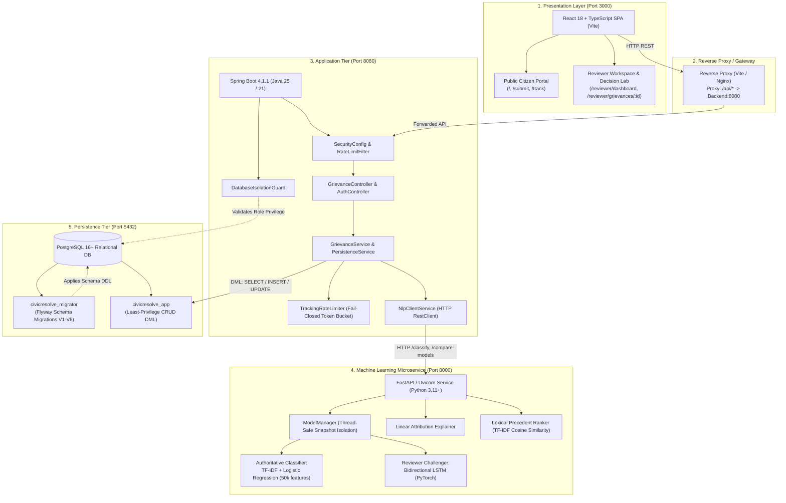
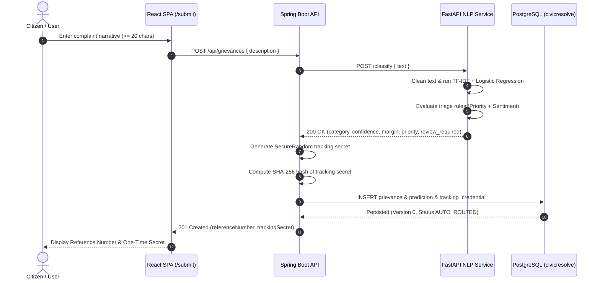
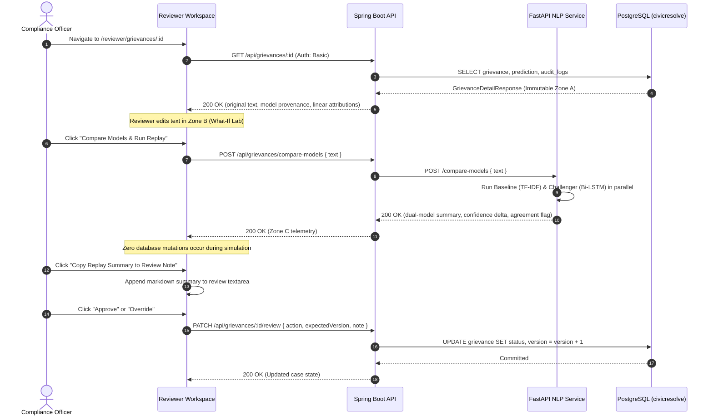

# CivicResolve AI — System Architecture & Data Flow

CivicResolve AI is an enterprise-grade consumer financial grievance triage and decision intelligence platform. It is engineered with a decoupled multi-tier architecture to support high-throughput citizen intake, explainable natural language processing, and human-in-the-loop compliance review.

---

## 1. High-Level Architectural Overview

The system comprises three independent service tiers communicating over typed REST APIs, supported by a PostgreSQL relational database with role-isolated security:

---

## 2. Service Responsibilities & Component Boundaries

### A. Presentation Tier (React 18 + TypeScript)
- **Framework**: React 18 SPA built with Vite and styled using Tailwind CSS.
- **State & Communication**:
  - `api-client.ts`: Standardized Fetch wrapper handling JSON serialization, HTTP Basic auth headers, timeout abort signals, and RFC 9457 Problem Details error translation.
  - `auth-client.ts`: In-memory credential session storage; authentication secrets are never saved to `localStorage` or `sessionStorage`.
- **Key Modules**:
  - `Intake`: Complaint submission form with client-side validation (20–5,000 characters) and pre-submission safeguard inspects.
  - `Tracking`: Public status lookups displaying scrubbed customer timelines.
  - `Reviewer`: Protected workspace containing the Triage Queue, SLA counters, and the Flagship Decision Intelligence Lab.

### B. Application Tier (Spring Boot 4.1.1)
- **Framework**: Spring Boot 4.1.1 running on Java 25 (Java 21 LTS compatible) with embedded Tomcat 11.
- **Security & Authorization**:
  - Spring Security with method-level `@PreAuthorize("hasRole('REVIEWER')")`.
  - BCrypt-12 credential hashing for reviewer accounts.
  - Public endpoint whitelist: `POST /api/grievances`, `POST /api/grievances/track`, `GET /api/product-categories`, `GET /api/health`.
- **Data Access & Concurrency**:
  - Spring Data JPA with Hibernate 7.
  - Optimistic locking via JPA `@Version` on the `Grievance` entity prevents review overwrite collisions (`HTTP 409 Conflict`).
  - Transaction boundary management via `@Transactional(readOnly = true)` for query paths.
- **Fail-Closed Rate Limiting**:
  - `TrackingRateLimiter`: Bounded in-memory token bucket protecting tracking lookups against enumeration attacks, fail-closed under capacity saturation.

### C. Machine Learning Microservice (FastAPI + Python)
- **Framework**: FastAPI running under Uvicorn with Pydantic v2 data contract validation.
- **Inference Strategy**:
  - **Production Intake Classifier**: Pre-trained TF-IDF vectorizer (1–2 n-grams, 50,000 features) + balanced Logistic Regression (`baseline_tfidf_logreg.joblib`). This is the sole model with authority to route complaints into the database.
  - **Challenger Neural Network**: 2-layer Bidirectional LSTM with masked pooling (`bilstm_best.pt`), reserved strictly for reviewer audit and counterfactual comparison.
  - **Explainability Engine**: Mathematical token-level linear attribution ($\mathbf{w}_c \cdot \mathbf{x}$) computing positive and negative token forces without stochastic variance.
  - **Precedent Ranker**: Cosine similarity computation across historical complaint TF-IDF vectors, ranking historical cases with PII masking.

---

## 3. End-to-End Data Flow

### A. Citizen Complaint Submission & Triage Flow

### B. Flagship Decision Intelligence Lab Flow

---

## 4. API Endpoint Directory

| Method | Endpoint | Access | Purpose |
| :--- | :--- | :--- | :--- |
| `POST` | `/api/grievances` | Public | Submit new consumer complaint for automated triage |
| `POST` | `/api/grievances/track` | Public (Rate-Limited) | Retrieve scrubbed public tracking status via Reference ID + Secret |
| `GET` | `/api/product-categories` | Public | List the 8 supported CFPB financial product categories |
| `GET` | `/api/health` | Public | Backend health probe, database status, and uptime |
| `GET` | `/api/auth/me` | Reviewer | Authenticate session and retrieve reviewer roles |
| `GET` | `/api/grievances` | Reviewer | Paginated, filterable reviewer queue |
| `GET` | `/api/grievances/stats` | Reviewer | Aggregated queue status counts and triage metrics |
| `GET` | `/api/grievances/{id}` | Reviewer | Detailed grievance record, original prediction, and audit trail |
| `PATCH` | `/api/grievances/{id}/review` | Reviewer | Submit human adjudication decision (Approve, Override, Reject) |
| `POST` | `/api/grievances/compare-models` | Reviewer | Run stateless dual-model side-by-side comparison |
| `POST` | `/api/grievances/preview-classify` | Reviewer | Stateless classification preview with linear feature attributions |
| `GET` | `/api/grievances/{id}/precedents` | Reviewer | Top-3 historical precedents ranked via Lexical TF-IDF Cosine Similarity |
| `GET` | `/api/grievances/analytics/overview` | Reviewer | Executive analytics metrics and category distributions |
| `GET` | `/api/grievances/analytics/calibration` | Reviewer | Model calibration metrics and reliability bin evaluations |
