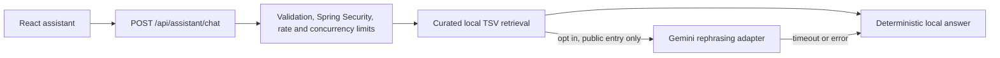

# CivicAssist AI engineering notes

CivicAssist is a read-only guide for the existing demonstration. It answers curated questions about citizen intake, tracking, review, and model interpretation. It does not read complaint records or modify cases. It runs locally without an external AI key.

## Request flow



The UI sends a question, an allowlisted page route, language (`en` or `hi`), explanation mode, and the previous **knowledge identifier** for follow-ups. It sends no raw conversation history. The server derives reviewer permission from Spring Security; a client role field is ignored. Reviewer-only topics are filtered before retrieval. The launcher is shared across routes and clears reviewer chat state on logout or exit from the protected workspace.

## Curated knowledge and retrieval

`backend/src/main/resources/assistant/knowledge.tsv` is the versioned corpus. Each entry has an identifier, category, version, title, audience, approved route, language, aliases, answer, and source path. Entries were checked against the current routes, enums, security policy, model card, and review flow. The corpus is not generated from arbitrary repository files or complaint records. Changes require review when source contracts change.

The service normalizes case and punctuation, removes a short stop-word list, applies a few explicit synonyms, scores exact aliases and overlapping words, and adds page and language bonuses only after a topical match. A low score returns an out-of-scope answer. Follow-ups use the prior knowledge ID subject to the same authorization check. This is **lexical retrieval**, with no vector database or semantic-search claim. Sources are displayed as titles; navigation actions use approved routes only. The retrieval score is never shown as model confidence.

## External provider and privacy boundary

Gemini is an optional provider behind `AssistantProvider`. External generation is **off by default**. The model ID must be supplied explicitly and verified against the account's current model list. The current implementation does not select a model or claim a benchmark winner because no provider credentials were available for a live comparison. Qwen integration was deferred: its documented trial quota is time-limited and does not establish a durable free API for this demonstration.

Only an English, public, matched knowledge entry may be sent to Gemini. The HTTP payload contains a static instruction, canonical topic ID, and approved public answer. It contains **no** raw question, history, complaint narrative or identifier, tracking secret, reviewer note, credential, or database record. Reviewer entries always remain local. The adapter has connection and request timeouts, a three-request concurrency cap, and a configurable daily cap. It returns the local answer on missing key, invalid model, HTTP errors including 429, timeout, invalid response, or quota exhaustion. No automatic paid fallback exists. Generated text is limited to 700 characters and links are rejected; React renders it as plain text. External paraphrases still need human quality review before enabling them for users. This limitation is why the default stays local.

The mock HTTP server test inspects the actual outbound payload and verifies that the configured key appears only in its HTTP header. The test cannot prove that every future corpus change is accurate or that a provider will obey the rewriting instruction.

## API

`POST /api/assistant/chat` is public. It accepts up to 500 characters in `question` and optional `page`, `language`, `mode`, `previousKnowledgeId` fields. Example:

```json
{"question":"What does classification confidence mean?","page":"/submit","language":"en","mode":"simple"}
```

Response fields: `answer`, `sources` (`id`, `title`, `reference`), `followUps`, `navigation`, `responseMode` (`local` or `generated`), `knowledgeId`, `warning`, and `model` (only for generated output). Validation errors use the existing Problem Detail handler; rate or concurrency exhaustion returns HTTP 429. The public limit is 20 requests per IP per 60 seconds, with a 4,096-key fail-closed capacity and 12 global concurrent requests. These are process-local limits and reset on restart; a multi-instance deployment needs shared enforcement. Only the direct connection IP is used; untrusted forwarded headers are ignored.

## Configuration and local setup

Start PostgreSQL, FastAPI NLP, Spring Boot, and Vite as described in [README.md](../README.md#quick-start). The assistant local mode needs no additional service or key. To test the optional Gemini path, set server-side environment variables **before** starting Spring Boot:

| Variable | Default | Meaning |
| --- | --- | --- |
| `CIVICASSIST_ENABLED` | `false` | Explicit opt-in for external generation |
| `CIVICASSIST_PROVIDER` | `gemini` | Implemented provider; other values remain local |
| `GEMINI_API_KEY` | empty | Server-only API key |
| `GEMINI_MODEL` | empty | Exact account-supported model ID |
| `CIVICASSIST_DAILY_REQUEST_LIMIT` | `100` | In-process UTC-day call cap |
| `CIVICASSIST_TIMEOUT_MS` | `4000` | HTTP connection and request timeout |

No `VITE_` environment variable should contain an AI provider key. Before enabling a free-tier provider, confirm current pricing, account quota, and provider data-use terms. [Google Gemini model list](https://ai.google.dev/gemini-api/docs/models), [Gemini pricing](https://ai.google.dev/gemini-api/docs/pricing), and [Alibaba Model Studio pricing](https://help.aliyun.com/en/model-studio/model-pricing) are the official starting points.

## Evaluation and limitations

`scripts/build_civicassist_evaluation.py` produces `backend/src/test/resources/assistant/evaluation.jsonl`: 150 questions, split into 120 development and 30 held-out variants. Topic counts are 25 citizen, 20 reviewer, 25 ML, 15 follow-up, 25 Hindi/Hinglish, 20 privacy, and 20 injection/unsupported. Each row records an expected knowledge ID and source, acceptable answer characteristics, and prohibited disclosures. The JUnit evaluator measures top-one topic matching and source hits and checks a few deterministic privacy invariants. Variants share 30 base questions, so the corpus is useful for regression but is **not** a broad independent human evaluation. A human reviewer has not scored factual correctness, groundedness, Hindi fluency, or prompt-injection resistance. Recall@K and MRR are not measured because the API currently returns one entry.

The measured offline run on 2026-11-26 matched 145/150 topics (96.7%), including 29/30 held-out variants. It reported 125 correct source hits; the 20 intentionally unsupported questions have no expected citation, so the relevant-topic source rate was 125/130 (96.2%). In the same JVM test, local retrieval median latency was 3.734 ms and P95 was 16.103 ms across 150 calls; this excludes HTTP, startup, and browser time. These are retrieval checks, **not** factual-accuracy or multilingual-quality scores. No live Gemini or Qwen benchmark, token usage, or generated-answer latency was measured. The local implementation does not fetch case-specific explanations; reviewers should use the existing case screen for those details. Hindi answers cover a small set of citizen topics; other queries may fall back to English or ask for clarification. The in-memory rate limit is per process.

## Tests and deployment impact

Backend tests cover local retrieval, role filtering, follow-up IDs, injection handling, rate limiting, MVC validation and authorization, and mock-server provider payloads. Frontend tests cover opening, submitting, sources, controls, contextual entry, and plain-text rendering. No database schema or model artifact changes are made. The assistant adds no mandatory infrastructure; provider-free local mode uses a small TSV corpus and simple in-process maps. Browser screenshots, live provider comparisons, process memory deltas, and database end-to-end checks require separate measured runs before claiming them as evidence.
