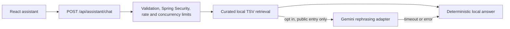

# CivicAssist AI engineering notes

CivicAssist is a read-only guide for the existing demonstration. It answers curated questions about citizen intake, tracking, review, and model interpretation. It does not read complaint records or modify cases. It runs locally without an external AI key.

## Request flow



The UI sends a question, an allowlisted page route, language (`en` or `hi`), explanation mode, and the previous **knowledge identifier** for follow-ups. It sends no raw conversation history. The server derives reviewer permission from Spring Security; a client role field is ignored. Reviewer-only topics are filtered before retrieval. The launcher is shared across routes and clears reviewer chat state on logout or exit from the protected workspace.

## Curated knowledge and retrieval

`backend/src/main/resources/assistant/knowledge.tsv` is the versioned corpus. Each entry has an identifier, category, version, title, audience, approved route, language, aliases, answer, and source path. Entries were checked against the current routes, enums, security policy, model card, and review flow. The corpus is not generated from arbitrary repository files or complaint records. Changes require review when source contracts change.

The corpus now has 45 curated entries, including 10 Hindi entries. The service applies Unicode NFKC normalization, preserves Hindi combining marks during tokenization, removes a short stop-word list, and uses explicit synonyms. Its lexical ranker weights exact aliases and title-word overlap, requires a meaningful topical match, and then adds page and language bonuses. It can cite two entries for a multi-intent question. A low score returns an out-of-scope answer. Follow-ups use the prior knowledge ID subject to the same authorization check and can switch between linked English and Hindi entries. This remains **lexical retrieval**, with no vector database, BM25, or semantic-search claim. The retrieval score is never shown as model confidence.

## External provider and privacy boundary

Gemini is an optional provider behind `AssistantProvider`. External generation is **off by default**. The model ID must be supplied explicitly and verified against the account's current model list. The current implementation does not select a model or claim a benchmark winner because no provider credentials were available for a live comparison. Qwen integration was deferred: its documented trial quota is time-limited and does not establish a durable free API for this demonstration.

Only one English, public, matched knowledge entry may be sent to Gemini. Multi-intent and reviewer answers stay local. The HTTP payload contains a static instruction, canonical topic ID and question title, and approved public answer. It contains **no** raw question, history, complaint narrative or identifier, tracking secret, reviewer note, credential, or database record. The adapter requests JSON with an answer and source ID; it rejects missing or wrong citations, links, oversized output, and words absent from approved knowledge. That conservative check can reject useful paraphrases, which then fall back to local text. It has connection and request timeouts, a three-request concurrency cap, a configurable daily cap, a bounded canonical-answer cache, and a 60-second circuit opening after repeated upstream failures. No automatic paid fallback exists. React renders answers as plain text. External paraphrases still need human quality review before enabling them for users; the default stays local.

The mock HTTP server test inspects the actual outbound payload and verifies that the configured key appears only in its HTTP header. The test cannot prove that every future corpus change is accurate or that a provider will obey the rewriting instruction.

## API

`POST /api/assistant/chat` is public. It accepts up to 500 characters in `question`; optional `page` must be an allowlisted route, `language` must be `en` or `hi`, `mode` must be `simple` or `technical`, and `previousKnowledgeId` is bounded to 64 safe characters. Example:

```json
{"question":"What does classification confidence mean?","page":"/submit","language":"en","mode":"simple"}
```

Response fields: `answer`, `sources` (`id`, `title`, `reference`), `followUps`, `navigation`, `responseMode` (`local` or `generated`), `knowledgeId`, `warning`, and `model` (only for generated output). Validation errors use the existing Problem Detail handler; rate or concurrency exhaustion returns HTTP 429. The public limit is 20 requests per client per 60 seconds, with an atomic 4,096-key capacity, expired-entry eviction, and 12 global concurrent requests. These limits are process-local. The direct connection IP is used by default. A proxy header is considered only when the direct peer matches an explicitly configured trusted proxy IP; the client address is selected from the rightmost untrusted numeric hop. Configure this only when the proxy appends or overwrites incoming `X-Forwarded-For` headers. A multi-instance deployment needs shared enforcement.

## Configuration and local setup

Start PostgreSQL, FastAPI NLP, Spring Boot, and Vite as described in [README.md](../README.md#quick-start). The assistant local mode needs no additional service or key. To test the optional Gemini path, set server-side environment variables **before** starting Spring Boot:

| Variable | Default | Meaning |
| --- | --- | --- |
| `CIVICASSIST_ENABLED` | `false` | Explicit opt-in for external generation |
| `CIVICASSIST_PROVIDER` | `gemini` | Implemented provider; other values remain local |
| `GEMINI_API_KEY` | empty | Server-only API key |
| `GEMINI_MODEL` | empty | Exact account-supported model ID |
| `CIVICASSIST_DAILY_REQUEST_LIMIT` | `100` | In-process UTC-day call cap |
| `CIVICASSIST_TIMEOUT_MS` | `4000` | HTTP connection and request timeout |
| `CIVICASSIST_TRUSTED_PROXY_IPS` | empty | Comma-separated direct proxy IPs; leave empty unless proxy header handling is verified |

No `VITE_` environment variable should contain an AI provider key. Before enabling a free-tier provider, confirm current pricing, account quota, and provider data-use terms. [Google Gemini model list](https://ai.google.dev/gemini-api/docs/models), [Gemini pricing](https://ai.google.dev/gemini-api/docs/pricing), and [Alibaba Model Studio pricing](https://help.aliyun.com/en/model-studio/model-pricing) are the official starting points.

## Evaluation and limitations

`scripts/build_civicassist_evaluation.py` produces the original 150-question prefix-variant **regression** corpus. Its expected topic was updated for the new, more specific tracking-secret entry. It is intentionally not presented as an independent quality benchmark. `scripts/build_civicassist_distinct_eval.py` produces a separate 100-question set with 80 development and 20 held-out questions covering distinct citizen, status, category, reviewer, model, Hindi/Hinglish, follow-up, ambiguous, privacy-attack, and unsupported intents. Held-out questions use different intents rather than cosmetic rewrites of development questions. Expected source paths and prohibited disclosures are recorded, but no human-reviewed reference answers were available. JUnit asserts minimum topic and citation counts plus complete rejection of the 25 questions labeled unsupported. A human reviewer has not scored factual correctness, answer completeness, groundedness, Hindi fluency, or prompt-injection resistance. Recall@K and MRR are not measured because the API does not return a ranked retrieval list.

Before review corrections, the regression corpus matched 145/150 topics with 125/130 expected source hits and 29/30 held-out variants. After knowledge expansion and targeted development-alias changes, it matched 150/150 topics and 130/130 expected sources. Because those questions repeat 30 bases, the improvement is not independent quality evidence. The distinct set measured **89/100** top-one topic matches, **68/75** expected source hits, **25/25** unsupported/attack rejections, and **14/20** held-out matches. JVM-only local retrieval median was 0.520 ms and P95 1.349 ms across the distinct set; these timings exclude HTTP and browser time. No live Gemini or Qwen benchmark, token usage, generated-answer latency, process-memory delta, or human quality score was measured. The assistant does not fetch case-specific explanations; reviewers should use the existing case screen. Hindi coverage is broader but incomplete, and the API states when a matched topic is available only in English.

## Tests and deployment impact

Backend tests cover local retrieval, role filtering, follow-up IDs, injection handling, rate-limit concurrency and expiry, MVC validation and authorization, missing-knowledge isolation, and mock-server provider payloads. Frontend tests cover opening, submitting, sources, controls, navigation persistence, logout cleanup, contextual entry, and plain-text rendering. No database schema or model artifact changes are made. The assistant adds no mandatory infrastructure. The local browser could not reach the Vite server from its isolated network, so genuine screenshots, browser console review, and responsive visual inspection remain unverified. Process memory and complete database-backed complaint journeys also remain unmeasured in this worktree.
